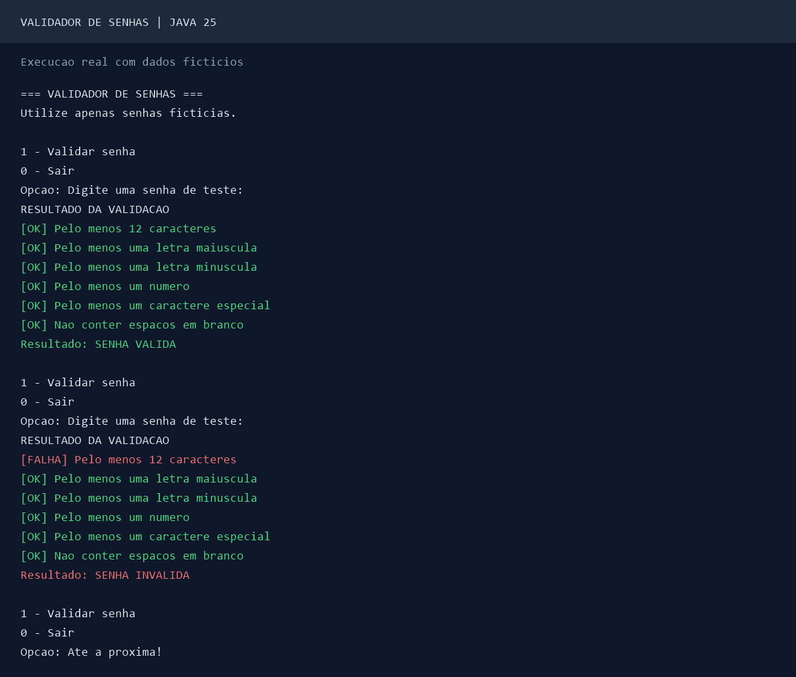

# Validador de Senhas em Java

Projeto 03/49 da trilha pessoal de portfólio.

Aplicação de console que avalia seis regras de composição
de senhas e apresenta um relatório detalhado.

## Tecnologias

- Java 25
- Maven
- JUnit 6
- GitHub Actions

## Regras implementadas

1. Pelo menos 12 caracteres
2. Pelo menos uma letra maiúscula
3. Pelo menos uma letra minúscula
4. Pelo menos um número
5. Pelo menos um caractere especial
6. Não conter espaços em branco

A avaliação das seis regras é independente.

## Arquitetura

- Main: interação pelo console.
- ValidadorSenha: implementação das verificações.
- RegraSenha: enum das regras disponíveis.
- ResultadoValidacao: record com lista imutável de falhas.

## Executar os testes

```powershell
mvn clean verify
```

## Executar a aplicação

```powershell
java -jar target/validador-senhas-java-1.0.0.jar
```

O menu permite validar novas entradas ou encerrar.

## Segurança e limitações

Este aplicativo é uma demonstração educacional.

Use exclusivamente senhas fictícias. Nunca informe
credenciais reais.

Quando há console compatível, Console.readPassword()
oculta a entrada. Em ambientes sem console dedicado,
a leitura ocorre pela entrada padrão e pode ser visível.

A aplicação não registra nem persiste as senhas.

As regras são didáticas e não constituem uma política
de autenticação segura para produção.

A implementação utiliza String e unidades UTF-16.
Uma solução de autenticação real exigiria outras
medidas, incluindo verificação de senhas comprometidas,
armazenamento com hash adequado e proteção contra
tentativas automatizadas.

## Testes automatizados

Testes JUnit verificam cada regra, o resultado
consolidado e o comportamento da interface.

## Demonstração



Imagem produzida a partir da saída real do programa
com entradas fictícias.

Transcrição:
[exemplo-execucao.txt](docs/exemplo-execucao.txt).

## Validação da entrega

- Java 25 e Maven.
- 61 testes automatizados JUnit aprovados localmente.
- Seis regras individuais.
- Relatório consolidado com enum e record.
- Menu interativo.
- JAR executável validado.
- GitHub Actions configurado.

## Segurança

Este projeto demonstra regras didáticas de composição
de senhas, não autenticação segura para produção.

Nunca utilize senhas reais nesta demonstração.
